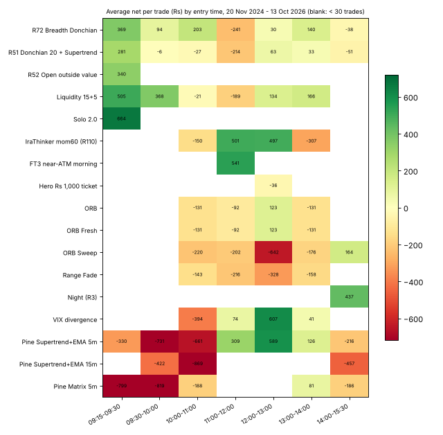
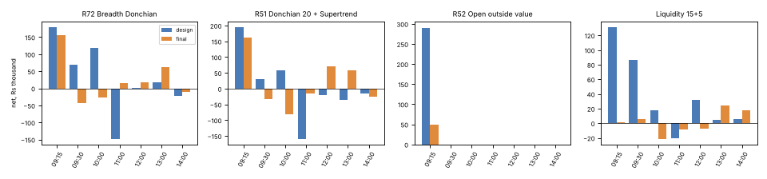

# R113: when does each strategy make (and lose) its money?

26 Oct 2026. Boss: *"Now check all the strategies we have, and find at what time each strategy made most profit, and find
a pattern between them."* A **descriptive** study: no rule is adopted from it. Pre-registration:
`research/hunt/r113_time_of_day/PREREG.md` (pushed before any number). Research only; nothing in the app changes.

## The answer first

**The money is made in the first 15 minutes.** For the four paper index arms (R72 Breadth Donchian, R51 Donchian 20 +
Supertrend, R52 Open outside value, Liquidity 15+5), entries filled 09:15-09:30 (in practice the 09:20 bar's break)
made **Rs 11.6 lakh of their Rs 11.8 lakh** over 20 Nov 2024 - 13 Oct 2026 (3,441 trades, 1 lot each, after charges).
**Every later entry together (8,947 trades) netted about Rs 17,500**: two years of churn for almost nothing. Solo 2.0
does the same (09:20 entries: 252 of its 294 trades, Rs 1.68 lakh of Rs 1.57 lakh). This held in **both** the design
period and the final window for R72 and R51 (the "sure" rows below: the 90% bootstrap band is above zero).

**The money is lost mid-morning and late.**
- 11:00-12:00 was the worst hour for R72 (-Rs 1.33 lakh), R51 (-Rs 1.76 lakh) and Liquidity (-Rs 28k), but for R72
  it was -Rs 1.48 lakh in design and **+Rs 15k** in the final: not stable.
- 10:00-11:00 entries made money in design and **lost** in the final for R72, R51 and Liquidity (09:30-10:00 too
  for R72 and R51).
- Entries from 14:00 lost in both periods for R72 (-Rs 22k / -Rs 9k) and R51 (-Rs 16k / -Rs 26k).

**But cutting those hours does not pass the tests.** All 7 pre-registered time filters (no entries 11:30-13:29, none
after 14:00, mornings only) beat today's rules over the whole design period, and **all 7 lost to today's rules in the
walk-forward year** (Apr 2025 - Mar 2026). So: rejected; nothing goes on paper. The pattern is real in the totals but
too unstable from year to year to trade. R112 found the same with a 10:00 cut for the Donchian arms.

**The other patterns, in one line each:**
- The arms win and lose **on the same days**: the best 10% of days (47 of 470) made **243%** of the four arms' net
  (the other 90% of days lost money overall), and on those days 3.4 of the 4 arms were green on average.
- R72 and R51 are **nearly the same bet** (daily P&L correlation 0.83 in design and in the final).
- **Fridays** carried R72, R51, R52 and Liquidity in design (R72 +Rs 3.07 lakh on Fridays vs +Rs 2.17 lakh in total),
  but not in the final (all weekdays small). **Night (R3)** makes all its money on **Friday-to-Monday holds**
  (+Rs 2.76 lakh of +Rs 2.72 lakh; the other weekdays net about zero).
- The breakout arms earn on **trend days** and lose on **range days** (an after-the-fact label: it explains, it cannot
  be a rule). VIX divergence is the mirror image (it fades moves: -Rs 2.05 lakh on trend days).
- The ORB family and the Pine scripts lose in every hour; the opening hour is the Pine scripts' worst.

## What was measured

Every arm's own backtest trade list, re-run unchanged from its own research code on the Drive lake (copied 26 Oct), then
cut by entry time, exit time, holding time, weekday, expiry day, opening gap (open vs previous close, +/-0.25%), the
previous session's India VIX (terciles of the design days), and day shape. Net is after each study's own charges and
slippage. Every bucket has its trade count; a bucket with fewer than 30 trades is marked **(small)** and is never a
finding; **(sure)** marks a bucket of 30+ trades whose 90% bootstrap band (resampling days) is all one side of zero.

| arm | source (code) | signal source | parity with its published figure |
|---|---|---|---|
| R72, R52, Liquidity 15+5 | R101 units on R106's engine (`adapters/core.py`) | index | **exact** (design and final, trades and rupees) |
| R51 Donchian 20 + Supertrend | R101's R51 signals + R73 T7 Supertrend filter (as R112, as on paper) | index | plain R51 exact; the Supertrend version has no published figure |
| Solo 2.0 | R57 A2 (`adapters/solo.py`) | index | design exact; final +Rs 1,565 (one day's pick; R106 saw the same) |
| Night (R3) | R27 baseline | index + day-end OI | exact |
| VIX divergence | R1 N13 | index vs VIX | final trade counts exact; design 6-7% fewer trades (lake prices differ) |
| FT3 near-ATM morning | R98 `ft3_app.py` | **clock + the option's own price** (not the default; reported apart) | exact |
| Hero Rs 1,000 ticket | R55 cell 1230-1505-T0 (the app's trail since 25 Oct) | clock + option price | exact (R55) |
| ORB, ORB Fresh, ORB Sweep, Range Fade | R3 engine (BANKNIFTY, as the app; parked since 13 Oct) | index | exact |
| ntfy / IraThinker mom60 | R110 S3 (NIFTY, BANKNIFTY monthly days only) | index | design exact |
| Pine Supertrend+EMA 5m / 15m, Pine Matrix 5m | h22 `pine_replay.py` (the app's Pine auto-trader) | index | within 2-8% on net |
| NG evening breakout | M3 EVE rule | the future | exact |
| SILVERM morning | M4 Q4 rule | the future (strike only) | exact |
| US-night silver | R2 C2 (Yahoo SI=F hourly re-fetched 26 Oct) | US silver overnight | exact |
| MCX 12-month trend | M2 TSM252 legs | the futures (daily) | **no**: LEAD is missing from the lake and the published book is a constrained portfolio |

"design / final" in the tables are each arm's **own** study periods (the four paper arms: design 20 Nov 2024 - 31 Mar
2026, final 1 Apr - 13 Oct 2026). Every final window here was read before (R27, R51-R112) except mom60's: R110 never read
its holdout, so this is its first, descriptive read.

## Cross-arm summary (each arm's whole record)

| arm | trades | net (Rs) | best entry window (trades, net) | worst entry window (trades, net) | share of net from first-hour entries | share of net from the best 10% of days |
|---|---:|---:|---|---|---:|---:|
| R72 Breadth Donchian | 4,273 | 388,295 | 09:15-09:30 (908, 335,365) | 11:00-12:00 (552, -132,983) | 86% | 284% |
| R51 Donchian 20 + Supertrend | 5,878 | 185,168 | 09:15-09:30 (1,273, 357,146) | 11:00-12:00 (820, -175,521) | 181% | 597% |
| R52 Open outside value | 999 | 339,185 | 09:15-09:30 (all of it) | - | 100% | 188% |
| Liquidity 15+5 | 1,238 | 268,404 | 09:15-09:30 (261, 131,854) | 11:00-12:00 (151, -28,491) | 71% | 195% |
| Solo 2.0 | 294 | 156,646 | 09:15-09:30 (252, 167,629) | 09:30-10:00 (25 small, -13,575) | 97% | 116% |
| Night (R3) | 869 | 272,171 | 15:20 (all), sold 09:16 next day | - | 0% | 236% |
| VIX divergence | 378 | 199,497 | 10:00-11:00 (127, 91,298) | 11:00-12:00 (101, 24,398) | 0% | 164% |
| FT3 near-ATM morning | 478 | 862,909 | 11:00-12:00 (401, 862,444) | 12:00-13:00 (77, 466) | 0% | 290% |
| Hero Rs 1,000 ticket | 355 | -12,948 | 12:30 (all) | - | 0% | - |
| mom60 (R110) | 411 | -7,320 | 11:00-12:00 (74, 30,595) | 14:00-15:30 (33, -27,935) | 0% | - |
| ORB / ORB Fresh | 1,207 | -123,935 | 12:00-13:00 (167, -8,279) | 10:00-11:00 (680, -80,464) | - | - |
| ORB Sweep | 1,677 | -299,428 | 14:00-15:30 (99, -485) | 10:00-11:00 (702, -132,070) | - | - |
| Range Fade | 1,843 | -286,033 | 13:00-14:00 (173, -17,513) | 11:00-12:00 (678, -115,456) | - | - |
| Pine Supertrend+EMA 5m | 1,576 | -186,234 | 12:00-13:00 (184, 34,120) | 09:15-09:30 (298, -84,860) | - | - |
| Pine Supertrend+EMA 15m | 545 | -157,389 | 12:00-13:00 (57, 914) | 09:30-10:00 (185, -54,791) | - | - |
| Pine Matrix 5m | 1,498 | -222,108 | 11:00-12:00 (21 small, 31,120) | 09:30-10:00 (287, -127,869) | - | - |
| NG evening breakout | 252 | 14,357 | 19:00-21:00 (233, 15,835) | 21:00-23:55 (19 small, -1,478) | - | 977% |
| SILVERM morning | 129 | 135,402 | 09:00-12:00 (80, 144,344) | 12:00-17:00 (49, -8,942) | - | 88% |
| US-night silver | 197 | 189,743 | 09:05 (all) | - | - | 107% |
| MCX 12-month trend | 130 | 775,778 | daily arm (not a time-of-day arm) | - | - | 143% |

A share above 100% means the rest of the arm's trades or days lost money together. "First hour" = entries 09:15-10:15.
FT3's money is from 2021-23: in the shared window (20 Nov 2024 - 13 Oct 2026) its 115 tickets lost Rs 58,771.





## Shared patterns

1. **The opening break is the edge.** Every arm with a real record that enters at the open (R72, R51, R52, Liquidity,
   Solo 2.0) makes most or all of its money from the 09:20 entries. This is R101's finding (the 09:20 bar is the Donchian
   arms' most valuable) seen across five arms. SILVERM morning is the MCX echo (its morning entries made all its money).
2. **After the open, the index arms are a coin toss.** R72's later entries netted +Rs 52,931 on 3,365 trades, R51's
   -Rs 1.72 lakh on 4,605 trades, Liquidity's +Rs 1.37 lakh on 977 (mostly design: Rs 10,139 in the final).
3. **The midday and late windows lose, but not every year.** 11:00-12:00 is the worst hour for three arms over the whole
   record, yet the sign flips between design and final; 14:00+ lost in both periods for R72 and R51 only by small sums.
4. **Short holds lose, full holds win (exit design, not the clock).** R72 / R51 trades that lasted 15 minutes or less
   (stop-outs) lost Rs 5.3 lakh and Rs 8.0 lakh in design; those that ran 15-30 minutes made Rs 7.5 lakh and Rs 8.5
   lakh. Liquidity's money is in trades held over an hour (+Rs 2.2 lakh in design on 54 trades held over 2 hours).
5. **Same days.** The four paper index arms win and lose together (on the worst 10% of days 3.4 of 4 were red). R72 and
   R51 correlate 0.83, R52 and Solo 0.41 / 0.70, the rest 0.2-0.45. Adding arms that fire on the same opening break
   does not spread risk.
6. **Concentration.** The best 10% of days carried 284% of R72's net, 597% of R51's, 195% of Liquidity's, 188% of R52's:
   without their best days, the arms lose. (R104 already found Trader Tom's "entries by 12:00" cut net, and R112 that a
   10:00 cut helps the Donchian arms in design but not in the walk-forward year: the same picture.)
7. **Gaps and VIX: no shared rule.** R52, Solo 2.0 and SILVERM morning make more on gap days than flat days (FT3 on
   gap-up days only), but
   the Donchian arms do not; no VIX tercile is consistently good or bad across arms or periods.

## The pre-registered follow-up rules (Part D)

Fixed in the PREREG; tested only where the design period showed the removed window losing (decided on design numbers,
`results/partD_select.json`, committed before the final read). 11 tests counted; 7 qualified and were run.
Gates: positive in design, walk-forward and final; above today's rules in walk-forward and final; 500 random-drop twins
(remove the same number of entries at random) with Benjamini-Hochberg q <= 0.10 over 5,840 tests; >= 40 final trades.

| test | design net (today's) | walk-forward net (today's) | final net (today's) | final trades | twin p | verdict |
|---|---:|---:|---:|---:|---:|---|
| R72, no entries 11:30-13:29 | 2,42,781 (2,16,929) | 3,09,904 (3,35,882) | 1,27,679 (1,71,366) | 900 | 0.65 | rejected |
| R51, no entries 11:30-13:29 | 1,07,200 (50,425) | 1,84,777 (2,13,748) | 76,248 (1,34,743) | 1,369 | 0.73 | rejected |
| Liquidity, no entries 11:30-13:29 | 2,65,815 (2,57,249) | 2,30,520 (2,38,064) | 21,901 (11,155) | 238 | 0.25 | rejected |
| R72, no entries from 14:00 | 2,38,754 (2,16,929) | 3,13,297 (3,35,882) | 1,80,748 (1,71,366) | 982 | 0.12 | rejected |
| R51, no entries from 14:00 | 66,326 (50,425) | 1,95,345 (2,13,748) | 1,60,562 (1,34,743) | 1,447 | 0.09 | rejected |
| R72, entries before 12:00 only | 2,17,990 (2,16,929) | 2,32,265 (3,35,882) | 1,00,144 (1,71,366) | 584 | 0.44 | rejected |
| R51, entries before 12:00 only | 1,22,303 (50,425) | 1,80,417 (2,13,748) | 32,641 (1,34,743) | 987 | 0.76 | rejected |
| R52 (all three rules), Liquidity mornings-only | not run: R52 only enters at 09:20; Liquidity's afternoons made money in design | | | | | not run |

Every run test fails "above today's rules in the walk-forward year". The two "no entries from 14:00" rules were the only
ones ahead in the final (R72 +Rs 9,382, R51 +Rs 25,819), with twin p 0.12 and 0.09: not significant (q = 1.0 over
5,840 tests; 0.68 for R113 alone). Nothing goes on paper.

## The phone's paper record (19-26 Oct)

From the phone's diagnostics (private repo, read only; rupees are hidden there, so points and % only): **27 round trips
over 6 sessions** (19, 20, 21, 22, 23, 26 Oct). R72: 11 trips, 6 wins (its two 09:20 entries on 26 Oct both lost,
-13.6% each on average; its four 11:00-13:00 entries all won). Liquidity: 6 trips, 1 win. R52: 3 trips, 1 win. Hero:
2 trips, 0 wins. NG evening, Solo 2.0, R51, US-night silver: 1-2 trips each. **Far too few to judge**; it neither
confirms nor contradicts the backtests. (`results/paper.json`.)

## What could go on paper

Nothing from R113: no tested rule passed. Ideas to pre-register and test later (not tested here):
- **"No entries from 14:00" for R72 and R51**: lost in both periods before, ahead in the final, behind in the
  walk-forward year. A fresh window (after 19 Oct) would settle it.
- **One opening bet, not two:** R72 and R51 take the same 09:20 break on the same days (correlation 0.83). A rule that
  lets only one of them take the opening break would cut the doubled risk without losing the edge; R108's same-direction
  cap is the nearest tested relative.
- **Friday / weekend holds**: Night (R3) earns only on Friday entries. A "Night on Fridays only" rule is worth a
  pre-registered test (it would also cut its trades by two thirds).

## Limits

- Each arm keeps its own study's periods, costs and size (1 lot, Rs 5,000 tickets for FT3), so rupees compare within an
  arm better than across arms.
- The final window was read before by R51-R112 (not fresh); mom60's holdout was read here for the first time,
  descriptively.
- R51 is modelled with its Supertrend filter as on paper; the arms are each alone (no same-direction cap; R108 models the
  shared book).
- The day-shape label uses the whole day, so it can never be a rule. The gap label is known at the open.
- The 12-month trend arm is a daily arm with one leg missing; its time buckets mean nothing (all entries at the open).
- The phone record covers 6 sessions.

## Every arm, by entry time

(All tables, plus exit time, holding time, weekday, expiry, gap, VIX and day shape for every arm and period:
`research/hunt/r113_time_of_day/results/report.md`.)

**R72 Breadth Donchian** (4,273 trades, net Rs 388,295, 2024-11-21 to 2026-10-13)

| entry | trades | win | net | design net | final net |
|---|---:|---:|---:|---:|---:|
| 09:15-09:30 (sure) | 908 | 55% | 335,365 | 178,533 | 156,832 |
| 09:30-10:00 | 279 | 45% | 26,119 | 69,965 | -43,846 |
| 10:00-11:00 | 441 | 48% | 89,634 | 117,496 | -27,862 |
| 11:00-12:00 | 552 | 40% | -132,983 | -148,003 | 15,020 |
| 12:00-13:00 | 686 | 43% | 20,681 | 2,170 | 18,511 |
| 13:00-14:00 | 577 | 48% | 80,686 | 18,594 | 62,093 |
| 14:00-15:30 | 830 | 43% | -31,207 | -21,825 | -9,382 |

**R51 Donchian 20 + Supertrend** (5,878 trades, net Rs 185,168, 2024-11-21 to 2026-10-13)

| entry | trades | win | net | design net | final net |
|---|---:|---:|---:|---:|---:|
| 09:15-09:30 (sure) | 1273 | 52% | 357,146 | 194,141 | 163,005 |
| 09:30-10:00 | 637 | 45% | -4,061 | 29,505 | -33,566 |
| 10:00-11:00 | 852 | 44% | -22,619 | 57,936 | -80,555 |
| 11:00-12:00 (sure) | 820 | 41% | -175,521 | -159,279 | -16,243 |
| 12:00-13:00 | 788 | 44% | 49,307 | -21,354 | 70,661 |
| 13:00-14:00 | 686 | 42% | 22,637 | -34,623 | 57,260 |
| 14:00-15:30 | 822 | 40% | -41,719 | -15,901 | -25,819 |

**R52 Open outside value** (999 trades, net Rs 339,185, 2024-11-21 to 2026-10-12)

| entry | trades | win | net | design net | final net |
|---|---:|---:|---:|---:|---:|
| 09:15-09:30 (sure) | 999 | 55% | 339,185 | 290,573 | 48,612 |

**Liquidity 15+5** (1,238 trades, net Rs 268,404, 2024-11-21 to 2026-10-13)

| entry | trades | win | net | design net | final net |
|---|---:|---:|---:|---:|---:|
| 09:15-09:30 (sure) | 261 | 51% | 131,854 | 130,838 | 1,017 |
| 09:30-10:00 (sure) | 251 | 41% | 92,420 | 86,906 | 5,513 |
| 10:00-11:00 | 196 | 40% | -4,058 | 17,284 | -21,342 |
| 11:00-12:00 | 151 | 33% | -28,491 | -20,388 | -8,103 |
| 12:00-13:00 | 181 | 38% | 24,298 | 31,893 | -7,595 |
| 13:00-14:00 | 177 | 40% | 29,417 | 4,986 | 24,432 |
| 14:00-15:30 (small) | 21 | 62% | 22,964 | 5,730 | 17,234 |

**Solo 2.0** (294 trades, net Rs 156,646, 2025-07-01 to 2026-10-14)

| entry | trades | win | net | design net | final net |
|---|---:|---:|---:|---:|---:|
| 09:15-09:30 (sure) | 252 | 60% | 167,629 | 73,064 | 93,564 |
| 09:30-10:00 (small) | 25 | 44% | -13,575 | -16,122 | 2,547 |
| 10:00-11:00 (small) | 7 | 29% | -6,458 | -3,178 | -3,280 |
| 11:00-12:00 (small) | 1 | 100% | 526 | 526 | - |
| 12:00-13:00 (small) | 7 | 57% | 9,018 | 1,495 | 7,523 |
| 14:00-15:30 (small) | 2 | 50% | -493 | 126 | -619 |

**Night (R3)** (869 trades, net Rs 272,171, 2021-08-31 to 2026-10-09)

| entry | trades | win | net | design net | final net |
|---|---:|---:|---:|---:|---:|
| 14:00-15:30 (sure) | 869 | 54% | 272,171 | 87,551 | 42,411 |

**VIX divergence** (378 trades, net Rs 199,497, 2022-01-05 to 2026-08-26)

| entry | trades | win | net | design net | final net |
|---|---:|---:|---:|---:|---:|
| 10:00-11:00 (sure) | 127 | 43% | 91,298 | 97,446 | -6,148 |
| 11:00-12:00 | 101 | 37% | 24,398 | 7,476 | 16,923 |
| 12:00-13:00 | 70 | 43% | 45,667 | 16,005 | 29,663 |
| 13:00-14:00 | 80 | 45% | 38,134 | 34,016 | 4,118 |

**FT3 near-ATM morning** (478 trades, net Rs 862,909, 2021-08-05 to 2026-10-19)

| entry | trades | win | net |
|---|---:|---:|---:|
| 11:00-12:00 (sure) | 401 | 18% | 862,444 |
| 12:00-13:00 | 77 | 10% | 466 |

**Hero Rs 1,000 ticket** (355 trades, net Rs -12,948, 2024-11-21 to 2026-10-13)

| entry | trades | win | net | design net | final net |
|---|---:|---:|---:|---:|---:|
| 12:00-13:00 | 355 | 18% | -12,948 | -14,507 | 1,559 |

**IraThinker mom60 (R110)** (411 trades, net Rs -7,320, 2024-04-18 to 2026-03-27)

| entry | trades | win | net | design net | final net |
|---|---:|---:|---:|---:|---:|
| 10:00-11:00 | 175 | 42% | -27,930 | -32,077 | 4,147 |
| 11:00-12:00 | 74 | 58% | 30,595 | 23,250 | 7,345 |
| 12:00-13:00 | 69 | 54% | 29,832 | 42,841 | -13,009 |
| 13:00-14:00 | 60 | 47% | -11,882 | 7,053 | -18,935 |
| 14:00-15:30 (sure) | 33 | 39% | -27,935 | -33,851 | 5,916 |

**ORB** (1,207 trades, net Rs -123,935, 2021-09-03 to 2026-10-12)

| entry | trades | win | net |
|---|---:|---:|---:|
| 10:00-11:00 (sure) | 680 | 38% | -80,464 |
| 11:00-12:00 (sure) | 244 | 36% | -22,677 |
| 12:00-13:00 | 167 | 40% | -8,279 |
| 13:00-14:00 | 116 | 37% | -12,515 |

**ORB Sweep** (1,677 trades, net Rs -299,428, 2021-09-03 to 2026-10-12)

| entry | trades | win | net |
|---|---:|---:|---:|
| 10:00-11:00 (sure) | 702 | 26% | -132,070 |
| 11:00-12:00 (sure) | 406 | 27% | -67,798 |
| 12:00-13:00 (sure) | 280 | 27% | -71,231 |
| 13:00-14:00 (sure) | 190 | 25% | -27,844 |
| 14:00-15:30 | 99 | 38% | -485 |

**Range Fade** (1,843 trades, net Rs -286,033, 2021-09-03 to 2026-10-12)

| entry | trades | win | net |
|---|---:|---:|---:|
| 10:00-11:00 (sure) | 675 | 28% | -103,351 |
| 11:00-12:00 (sure) | 678 | 32% | -115,456 |
| 12:00-13:00 (sure) | 317 | 32% | -49,713 |
| 13:00-14:00 (sure) | 173 | 30% | -17,513 |

**PINE_ST_EMA_5M** (1,576 trades, net Rs -186,234, 2021-08-04 to 2026-10-13)

| entry | trades | win | net | design net | final net |
|---|---:|---:|---:|---:|---:|
| 09:15-09:30 | 298 | 33% | -84,860 | -6,537 | -35,348 |
| 09:30-10:00 | 125 | 30% | -42,316 | -31,463 | -11,671 |
| 10:00-11:00 | 168 | 33% | -35,295 | -8,326 | -29,334 |
| 11:00-12:00 | 151 | 35% | 10,343 | 24,686 | -2,405 |
| 12:00-13:00 | 184 | 35% | 34,120 | 5,249 | 38,915 |
| 13:00-14:00 | 234 | 33% | -26,261 | 8,923 | 3,083 |
| 14:00-15:30 | 416 | 40% | -41,966 | -19,540 | -15,812 |

**PINE_ST_EMA_15M** (545 trades, net Rs -157,389, 2021-08-04 to 2026-10-13)

| entry | trades | win | net | design net | final net |
|---|---:|---:|---:|---:|---:|
| 09:30-10:00 | 185 | 44% | -54,791 | 26,872 | -63,159 |
| 10:00-11:00 | 89 | 35% | -46,285 | -24,721 | -10,023 |
| 11:00-12:00 | 48 | 44% | -15,843 | -26,764 | -13,731 |
| 12:00-13:00 | 57 | 49% | 914 | -19,903 | 7,801 |
| 13:00-14:00 | 53 | 43% | -22,943 | -2,181 | -8,203 |
| 14:00-15:30 | 113 | 31% | -18,441 | -22,144 | 3,846 |

**PINE_MATRIX_5M** (1,498 trades, net Rs -222,108, 2021-08-04 to 2026-10-13)

| entry | trades | win | net | design net | final net |
|---|---:|---:|---:|---:|---:|
| 09:15-09:30 (sure) | 123 | 29% | -98,323 | -51,397 | -2,127 |
| 09:30-10:00 (sure) | 287 | 30% | -127,869 | -80,283 | -3,291 |
| 10:00-11:00 | 328 | 35% | -25,102 | -24,150 | -2,320 |
| 11:00-12:00 (small) | 21 | 52% | 31,120 | -10,951 | 33,046 |
| 13:00-14:00 | 399 | 40% | -9,075 | -19,708 | 32,780 |
| 14:00-15:30 | 340 | 39% | 7,142 | -9,002 | -18,971 |

**NG evening breakout** (252 trades, net Rs 14,357, 2025-08-06 to 2026-10-07)

| entry | trades | win | net | design net | final net |
|---|---:|---:|---:|---:|---:|
| 19:00-21:00 | 233 | 45% | 15,835 | 12,487 | 3,348 |
| 21:00-23:55 (small) | 19 | 42% | -1,478 | -3,267 | 1,789 |

**SILVERM morning** (129 trades, net Rs 135,402, 2025-08-28 to 2026-10-07)

| entry | trades | win | net | design net | final net |
|---|---:|---:|---:|---:|---:|
| 09:00-12:00 (sure) | 80 | 69% | 144,344 | 101,356 | 42,988 |
| 12:00-17:00 | 49 | 43% | -8,942 | 10,868 | -19,810 |

**US-night silver** (197 trades, net Rs 189,743, 2025-08-06 to 2026-10-06)

| entry | trades | win | net | design net | final net |
|---|---:|---:|---:|---:|---:|
| 09:00-12:00 (sure) | 197 | 55% | 189,743 | -7,631 | 197,375 |

**MCX 12-month trend** (130 trades, net Rs 775,778, 2013-01-02 to 2026-03-02)

| entry | trades | win | net | design net | final net |
|---|---:|---:|---:|---:|---:|
| overnight (sure) | 130 | 35% | 775,778 | 427,986 | 347,792 |


## Reproduce

```bash
rclone copy gdrive:IraAlgo-data-lake/<datasets> ~/.cache/iraalgo/lake        # see PREREG / each adapter's json
R51_CLEAN=1 python research/hunt/r51/r51data.py build
python research/hunt/r113_time_of_day/adapters/core.py export               # and the other adapters/*.py
python research/hunt/r113_time_of_day/r113study.py select && ... design && ... final && ... describe
python research/hunt/r113_time_of_day/r113study.py paper <diag folder>
python research/hunt/r113_time_of_day/r113report.py && python research/hunt/r113_time_of_day/make_entries.py
python -m pytest research/hunt/r113_time_of_day -q
```
