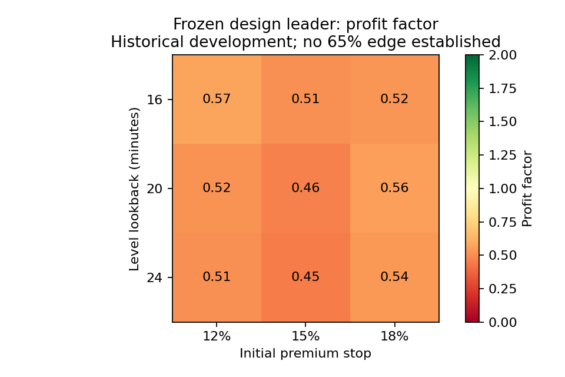
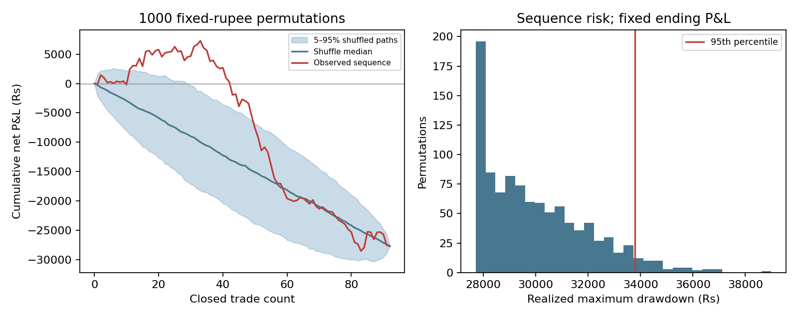

# Search for a 65%-win, cost-profitable NIFTY option strategy

**No validated 65% profitable strategy was established. No paper/live promotion.**
Period 2025-10-20–2026-10-19; 247 sessions;100000 rupees starting capital per full account.
Tested 40 unique rule/settings combinations, each at normal and doubled execution friction. Support/resistance, breakouts, sweep/reclaim, mean reversion, option volume/OI, modeled delta/IV, signed-volume proxy and observed futures volume/VWAP/profile are explicitly separated.
Normal-friction arms with at least100trades and point winrate>=65%: 0. The highest sufficiently sampled win rate was 49.58% on 240 trades, net Rs-39497.44 (range_fade__plain__t0.10__l20__s0.15__x1.0).

## All primary replay results

| Rule | Trades | Net win % | Net Rs | 2x friction net Rs | PF | Realized DD Rs | Wilson95% win interval | Block BH q |
|---|---:|---:|---:|---:|---:|---:|---|---:|
| breakout__plain__t0.30__l20__s0.15 | 173 | 41.04 | -39585.26 | -39315.04 | 0.62 | 39585.26 | 34.0–48.5% | 1.000 |
| breakout__plain__t0.10__l20__s0.15 | 169 | 48.52 | -39237.20 | -39825.36 | 0.61 | 39447.01 | 41.1–56.0% | 1.000 |
| breakout__chain__t0.30__l20__s0.15 | 151 | 39.07 | -37002.51 | -38686.11 | 0.55 | 38629.65 | 31.7–47.0% | 1.000 |
| breakout__chain__t0.10__l20__s0.15 | 136 | 42.65 | -36092.80 | -39237.29 | 0.51 | 39680.92 | 34.6–51.0% | 1.000 |
| breakout__greek_proxy__t0.30__l20__s0.15 | 163 | 41.10 | -39541.16 | -39981.65 | 0.60 | 39541.16 | 33.8–48.8% | 1.000 |
| breakout__greek_proxy__t0.10__l20__s0.15 | 197 | 49.24 | -39327.64 | -39445.47 | 0.63 | 39537.45 | 42.3–56.2% | 1.000 |
| breakout__all__t0.30__l20__s0.15 | 39 | 33.33 | -10408.57 | -14348.61 | 0.52 | 11827.09 | 20.6–49.0% | 1.000 |
| breakout__all__t0.10__l20__s0.15 | 40 | 32.50 | -15454.07 | -19493.49 | 0.32 | 15845.99 | 20.1–48.0% | 1.000 |
| sweep__plain__t0.30__l20__s0.15 | 170 | 40.59 | -37533.71 | -38227.47 | 0.61 | 39965.92 | 33.5–48.1% | 1.000 |
| sweep__plain__t0.10__l20__s0.15 | 234 | 48.72 | -39030.72 | -39332.32 | 0.66 | 39947.40 | 42.4–55.1% | 1.000 |
| sweep__chain__t0.30__l20__s0.15 | 92 | 36.96 | -27714.30 | -35662.04 | 0.46 | 35831.07 | 27.8–47.2% | 1.000 |
| sweep__chain__t0.10__l20__s0.15 | 92 | 39.13 | -31249.10 | -37700.11 | 0.39 | 34243.17 | 29.8–49.3% | 1.000 |
| sweep__greek_proxy__t0.30__l20__s0.15 | 237 | 42.19 | -29868.28 | -37513.46 | 0.74 | 38927.53 | 36.1–48.6% | 1.000 |
| sweep__greek_proxy__t0.10__l20__s0.15 | 208 | 48.08 | -37556.11 | -39122.73 | 0.63 | 39249.73 | 41.4–54.8% | 1.000 |
| sweep__all__t0.30__l20__s0.15 | 0 | n/a | 0.00 | 0.00 | n/a | 0.00 | n/a | 1.000 |
| sweep__all__t0.10__l20__s0.15 | 0 | n/a | 0.00 | 0.00 | n/a | 0.00 | n/a | 1.000 |
| previous_reclaim__plain__t0.30__l20__s0.15 | 138 | 40.58 | -20145.13 | -35243.56 | 0.73 | 20145.13 | 32.7–48.9% | 1.000 |
| previous_reclaim__plain__t0.10__l20__s0.15 | 141 | 45.39 | -32939.02 | -39248.12 | 0.56 | 32939.02 | 37.4–53.6% | 1.000 |
| previous_reclaim__chain__t0.30__l20__s0.15 | 30 | 40.00 | -3718.49 | -6541.54 | 0.78 | 8297.76 | 24.6–57.7% | 1.000 |
| previous_reclaim__chain__t0.10__l20__s0.15 | 30 | 43.33 | -8634.48 | -11522.71 | 0.48 | 9586.12 | 27.4–60.8% | 1.000 |
| previous_reclaim__greek_proxy__t0.30__l20__s0.15 | 115 | 44.35 | -9941.08 | -22334.58 | 0.83 | 12305.39 | 35.6–53.5% | 1.000 |
| previous_reclaim__greek_proxy__t0.10__l20__s0.15 | 117 | 47.01 | -24093.79 | -36788.65 | 0.59 | 25753.12 | 38.2–56.0% | 1.000 |
| previous_reclaim__all__t0.30__l20__s0.15 | 0 | n/a | 0.00 | 0.00 | n/a | 0.00 | n/a | 1.000 |
| previous_reclaim__all__t0.10__l20__s0.15 | 0 | n/a | 0.00 | 0.00 | n/a | 0.00 | n/a | 1.000 |
| range_fade__plain__t0.30__l20__s0.15 | 255 | 44.31 | -37384.74 | -39396.06 | 0.69 | 39003.63 | 38.3–50.5% | 1.000 |
| range_fade__plain__t0.10__l20__s0.15 | 240 | 49.58 | -39497.44 | -39962.59 | 0.64 | 39497.44 | 43.3–55.9% | 1.000 |
| range_fade__chain__t0.30__l20__s0.15 | 40 | 45.00 | -9012.88 | -9866.49 | 0.57 | 9697.87 | 30.7–60.2% | 1.000 |
| range_fade__chain__t0.10__l20__s0.15 | 40 | 45.00 | -9693.40 | -11728.56 | 0.54 | 10279.11 | 30.7–60.2% | 1.000 |
| range_fade__greek_proxy__t0.30__l20__s0.15 | 99 | 38.38 | -28007.63 | -37800.88 | 0.47 | 28007.63 | 29.4–48.2% | 1.000 |
| range_fade__greek_proxy__t0.10__l20__s0.15 | 100 | 41.00 | -29958.39 | -38967.73 | 0.41 | 29958.39 | 31.9–50.8% | 1.000 |
| range_fade__all__t0.30__l20__s0.15 | 0 | n/a | 0.00 | 0.00 | n/a | 0.00 | n/a | 1.000 |
| range_fade__all__t0.10__l20__s0.15 | 0 | n/a | 0.00 | 0.00 | n/a | 0.00 | n/a | 1.000 |
| sweep__chain__t0.30__l16__s0.12 | 113 | 36.28 | -26788.36 | -36453.62 | 0.57 | 36598.69 | 28.0–45.5% | 1.000 |
| sweep__chain__t0.30__l16__s0.15 | 104 | 35.58 | -28300.97 | -37264.12 | 0.51 | 36854.86 | 27.0–45.1% | 1.000 |
| sweep__chain__t0.30__l16__s0.18 | 88 | 36.36 | -21392.67 | -23240.09 | 0.52 | 27714.18 | 27.1–46.8% | 1.000 |
| sweep__chain__t0.30__l20__s0.12 | 100 | 37.00 | -26655.07 | -33466.82 | 0.52 | 35511.54 | 28.2–46.8% | 1.000 |
| sweep__chain__t0.30__l20__s0.18 | 80 | 40.00 | -17069.78 | -18115.03 | 0.56 | 21773.70 | 30.0–51.0% | 1.000 |
| sweep__chain__t0.30__l24__s0.12 | 95 | 35.79 | -26978.63 | -33311.72 | 0.51 | 35066.18 | 26.9–45.8% | 1.000 |
| sweep__chain__t0.30__l24__s0.15 | 87 | 35.63 | -28246.25 | -36098.02 | 0.45 | 35594.11 | 26.4–46.1% | 1.000 |
| sweep__chain__t0.30__l24__s0.18 | 75 | 38.67 | -17759.00 | -18323.79 | 0.54 | 21814.15 | 28.5–50.0% | 1.000 |

## Frozen development leader

Descriptive leader: `sweep__chain__t0.30__l20__s0.15`. Selected on first-window stressed net among rules with>=30 normal trades; it was not a passing strategy and was frozen before later-window replay. Full normal: 92 trades, 36.96% wins, Rs-27714.30 net; stress Rs-35662.04.

| Window (separate diagnostic account) | Trades | Win % | Normal net Rs | Stress net Rs |
|---|---:|---:|---:|---:|
| design | 43 | 53.49 | -1944.03 | -8567.29 |
| q2 | 18 | 16.67 | -17875.69 | -17628.58 |
| q3 | 31 | 25.81 | -7894.57 | -11380.70 |

## Walk-forward selection

The selector sees only preceding dates; test accounts carry cash/peak/monthly risk across folds. A rule requires>=100 preceding trades,>=65% wins, positive normal/stress net, PF>1 and the registered risk gates. No qualifying rule means no trade.

| Prior data through | Evaluation begins | Qualified rules | Locked choice |
|---|---|---:|---|
| 2026-03-30 | 2026-04-01 | 0 | NO_TRADE |
| 2026-06-30 | 2026-07-01 | 0 | NO_TRADE |

Walk-forward normal net: Rs0.00. A no-trade outcome is not evidence of a profitable edge. Dates were reused by previous studies, so this is chronological development evidence, not pristine out-of-sample proof.

## Parameter sensitivity

Only the design-selected family/context/target is varied. All nine cells are shown; the center was already in the32 primary rules, so eight extra rules were counted. No later-window parameter optimization.

| Lookback | Stop % | Trades | Win % | Normal net Rs | Stress net Rs | PF |
|---:|---:|---:|---:|---:|---:|---:|
| 20 | 15 | 92 | 36.96 | -27714.30 | -35662.04 | 0.46 |
| 16 | 12 | 113 | 36.28 | -26788.36 | -36453.62 | 0.57 |
| 16 | 15 | 104 | 35.58 | -28300.97 | -37264.12 | 0.51 |
| 16 | 18 | 88 | 36.36 | -21392.67 | -23240.09 | 0.52 |
| 20 | 12 | 100 | 37.00 | -26655.07 | -33466.82 | 0.52 |
| 20 | 18 | 80 | 40.00 | -17069.78 | -18115.03 | 0.56 |
| 24 | 12 | 95 | 35.79 | -26978.63 | -33311.72 | 0.51 |
| 24 | 15 | 87 | 35.63 | -28246.25 | -36098.02 | 0.45 |
| 24 | 18 | 75 | 38.67 | -17759.00 | -18323.79 | 0.54 |

Healthy neighboring cells: 0/8, requiring>=100trades, PF>1 and positive normal AND stressed net. This is stricter than a PF-only green heatmap.

## Monte Carlo: fixed development leader

| Friction | Actual realized DD Rs | Shuffled DD95 Rs | Shuffled DD99 Rs | Five-day-block DD95 Rs | Five-day-block net95% interval Rs |
|---|---:|---:|---:|---:|---|
| 1.0x | 35831.07 | 33784.05 | 35855.11 | 46274.26 | -46952.76 to -6923.26 |
| 2.0x | 38581.50 | 39085.75 | 40187.09 | 51436.70 | -54124.85 to -19715.20 |

1000 shuffles retain every fixed-rupee trade P&L, so total profit is unchanged. They assess order risk, not whether the strategy has an edge. The1000 five-day block resamples retain within-day order and zero-trade days. Neither resimulation reruns cash/risk gates under reordered signals, models intratrade worst drawdown or justifies position sizing on its own.

## What was measured and what was not

Observed futures sessions: 57. Far-month coverage limits that gate; zero or tiny samples cannot pass. Approximate profile assigns each futures minute's volume to its typical-price25-point bin. It is not a footprint or true traded volume-at-price.
Option OI/volume are observed, but OI has no unique buyer/seller directional interpretation. Both sides of an open contract exist. PCR/OI-change filters are hypotheses, not verified smart-money labels. Changes compare the SAME strike and side at exact five-minute timestamps. Reported IV uses its percent scale; invalid/zero IV fails Greek gates. Black-Scholes delta uses reported IV, scheduled expiry and6.5% rate; it is a model exposure, not aggressor delta.
Signed minute volume uses the option candle body sign and is explicitly a PROXY. Resting liquidity, spoofing, actual stop executions, market depth and true buyer/seller delta were not tested. Phone recordings remain encrypted. A sweep detector proves a price-level crossing/reclaim, not a liquidity raid.
Orders are simulated at next-minute option opens, fixed strike/expiry throughout. OHLC fills use conservative stop-first ordering; a touched order is not guaranteed executable. Brokerage, taxes and modeled spread/slippage are included. Square-off14:50; initial stop15%, targets10%/30%, max45minutes and existing profit lock/time stop. One lot, max2trades/day and cash/daily/monthly/drawdown limits. Sensitivity stops12%/18% change both exits and admission risk consistently.
All80 full-account p-values are day-block based and BH adjusted. This does not repair selection across the previously inspected research program. Win-rate Wilson intervals assume independent trades; day clustering can make that optimistic. A dependable65% claim needs new data and a lower confidence bound at least65%, not just a selected historical point estimate.

## Why65% wins can still lose

With average gross win W, average gross loss L and average cost C, expectancy=pW−(1−p)L−C; break-even p=(L+C)/(W+L). A65% win rate on Rs100 wins and Rs300 losses loses Rs4000 per100trades before costs. Accuracy, win rate and account return are different quantities.

See ../PREREG.md, ../SOURCES.md, audit.json, design_selection.json, results.json and saved leader/WF ledgers. No paid resources, production changes, real trades or claim of exhaustive internet coverage.

## Diagnostic figures

