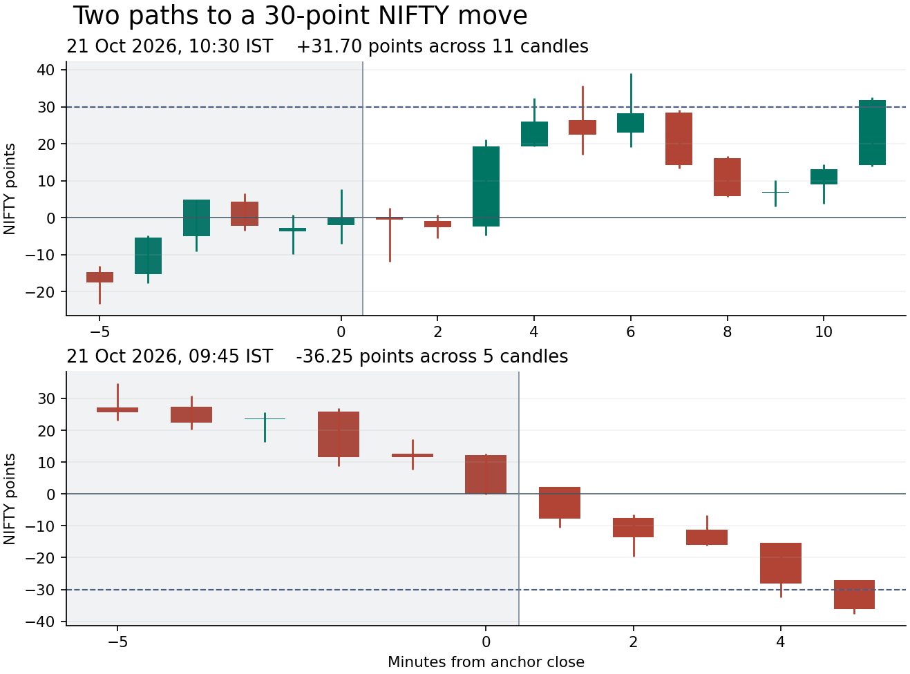

# Working backward from a 20–40 point move

## The question

What was already visible before NIFTY moved, what developed while it moved, and how often did a similar start fail? Study period 14 November 2025–13 November 2026, using one-minute closes and 248 sessions. One point here is one NIFTY spot index point. A separate replay measures points in the option premium. This is an observational study of historical moves. It supplies no executable win rate.

## Event definition

Anchor at a completed minute close every 15 minutes starting at 09:45 IST. Follow the next 15 closes. At each threshold separately, record the direction of the first crossing or classify the window as quiet at that threshold. Include both one-candle and multi-candle events. These fixed anchors prevent choosing perfect swing lows and highs after the fact. They miss moves that straddle adjacent windows. The shifted-grid comparison moves every anchor five minutes later. The maximum absolute excursion bins in results/excursion_bands.csv are mutually exclusive. In the later period, 103 windows reached 20–under 30, 65 reached 30–under 40, 100 reached at least 40, and 107 stayed below 20.

| Window and period | 20-point rise/fall | 30-point rise/fall | 40-point rise/fall |
|---|---:|---:|---:|
| 21 October–13 November, 375 windows | 140 / 128 | 78 / 87 | 46 / 54 |

For a 30-point crossing, median elapsed time was eight candles in either direction. Of the 78 rises, 77 took multiple candles; of the 87 falls, 85 took multiple candles. The median share of candle bodies pointing with the move was 67% for rises and 75% for falls. The 375 windows come from a later period reserved in the new comparison; the same dates were studied in earlier IraAlgo research. No new holdout remains after studying these outcomes.

## What preceded the move

The discovery period provided 5,060 windows, with 753 first upward 30-point crossings, 791 downward and 3,516 quiet. When the preceding 15-minute high–low range reached 40 points, 49.3% of anchors crossed 30 points either way in discovery versus 21.6% without that condition after matching the time of day. In the later sample the comparison was 51.2% versus 36.2%. This identifies a more active environment. Its directional estimates were imprecise in the later sample and the upward estimate was sensitive to moving the grid five minutes.

We tested 13 conditions across three thresholds and both directions. They covered range, compression, five-minute momentum, three candle bodies, related indices, VIX, breakouts, failed breaks, opening-range edges, fixed-strike premium momentum, IV expansion, relative OI change and option volume. Signal and comparison windows were standardized by clock block and prior-range tercile where applicable. Three labelled and three comparison windows per stratum were required. CIs use session-clustered sandwich errors; the shorter period has only 18 sessions. Benjamini–Hochberg q-values are reported separately per period and grid. None of the 30-point directional signals cleared q < .05 in the later primary-grid sample. Market-wide agreement after a move has started can look far stronger than the information at its start.

## How the move developed

The 59-stock equity tape gives a view of participation. Across 158 of the 165 later 30-point moves with a quiet same-session comparison and adequate price coverage, an average of 49.8% of stocks had moved in the eventual direction in the prior five minutes. During the move that rose to 84.1%. Matched quiet windows measured over the same elapsed minutes averaged 48.4% in the event's direction. Controls were chosen within 90 minutes of the case and matched on time and preceding range; some controls repeat. The universe is the lake's fixed equity basket. Index weights, historical constituent membership, initiating orders and news timestamps were unavailable here. Contemporaneous breadth is partly mechanical since the indices share constituents.

The +10/-10 landmark test separates continuations from failed starts. At the first completed close at least 10 but under 30 points from the anchor, observe the state, then ask whether it reaches 30 points in that direction before a close returns to the anchor or the original 15 minutes expire. Later sample: 357 eligible starts, 129 continued (36.1%), 144 returned to or crossed the starting level (40.3%) and 84 timed out (23.5%). With all four other indices agreeing, 120/308 continued (39.0%); with fewer agreeing, 9/49 continued (18.4%). After matching elapsed time and the points already covered at the first crossing, the gap narrowed to 5.5 percentage points (approximate day-cluster 95% CI -14.8 to +25.9). A 70%-stock-agreement screen showed a +6.2-point matched difference in discovery, then -4.0 points in the later sample. This exploratory comparison explains why measuring only successful continuations can give a misleading impression of timing ability.

## What explained a 30-point option premium change?

Using the anchor ATM call and put, follow each absolute strike and the inferred front-week expiry. The 750 complete later-period contract windows supplied 57 upward and 37 downward first crossings at 30 premium points. Reprice the European option while changing spot, provider-reported IV and time to expiry. Average all six orders of changing those inputs to allocate their interactions. Keep interest and dividend rates at zero over the short interval. The residual reconciles the theoretical change with the observed premium move.

| Later-period premium event | Events | Observed mean points | Spot component | IV component | Time component | Residual |
|---|---:|---:|---:|---:|---:|---:|
| Premium rose at least 30 | 57 | +34.99 | +28.40 | +6.96 | -0.43 | +0.06 |
| Premium fell at least 30 | 37 | -32.89 | -29.21 | -2.85 | -0.50 | -0.33 |

Spot was the largest modeled component in all 94 later-period 30-point crossings. This is retrospective price attribution. IV is itself implied from prices, so its component cannot independently establish an external volatility shock. The tables also cover 20- and 40-point thresholds, both option sides and excluded-IV coverage. These are first crossings in selected fixed windows; the numbers cannot be applied to every option strike or used as expected trading profit.

## Two actual paths



On 21 October at the 09:45 bar, NIFTY had already fallen 25.60 points over five minutes. It fell another 36.25 points over five candles, all red; 52/59 observed stocks fell during that leg. RELIANCE fell 0.31%, while HDFCBANK rose 0.15%. The 23,100 put premium rose 16.70 points.

At the 10:30 bar the same day, NIFTY had risen 17.55 points in five minutes. It then gained 31.70 points over eleven candles, only six green. All four comparison indices rose and 45/59 stocks rose. The 22,950 call premium gained 22.85 points. These are the first qualifying multi-candle cases in each direction in the later sample. Option price changes are measured fixed-strike closes and exclude costs.

## Reproduce

Run from repository root after staging the 21 files pinned in research/iraalgo_forward/run/audit.json. Also provide equity_1m_2025.parquet, equity_1m_2026.parquet and equity_1m_2026_fill1013-1113.parquet from the Drive equity_1m directory. Use the original 2026 NIFTY gap file for the example chart.

```bash
R=research/move_attribution/results
python -m research.move_attribution.events /path/to/staged /tmp/moves.parquet
python -m research.move_attribution.compare /tmp/moves.parquet "$R"
python -m research.move_attribution.equity /tmp/equities.parquet /path/to/equity_1m_2025.parquet /path/to/equity_1m_2026.parquet /path/to/equity_1m_2026_fill1013-1113.parquet
python -m research.move_attribution.constituents /tmp/moves.parquet /path/to/equity_1m_2026_fill1013-1113.parquet "$R"
python -m research.move_attribution.continuation /path/to/staged /tmp/moves.parquet /tmp/equities.parquet "$R"
python -m research.move_attribution.premiums /path/to/staged /tmp/moves.parquet "$R"
python -m research.move_attribution.figure /path/to/staged/index_1m_NIFTY_2026_gap1113.parquet "$R"
```

The event ledger remains local with the input data. Aggregate tables, matched effects, source code, and the figure are provided here. No broker connection is used.
